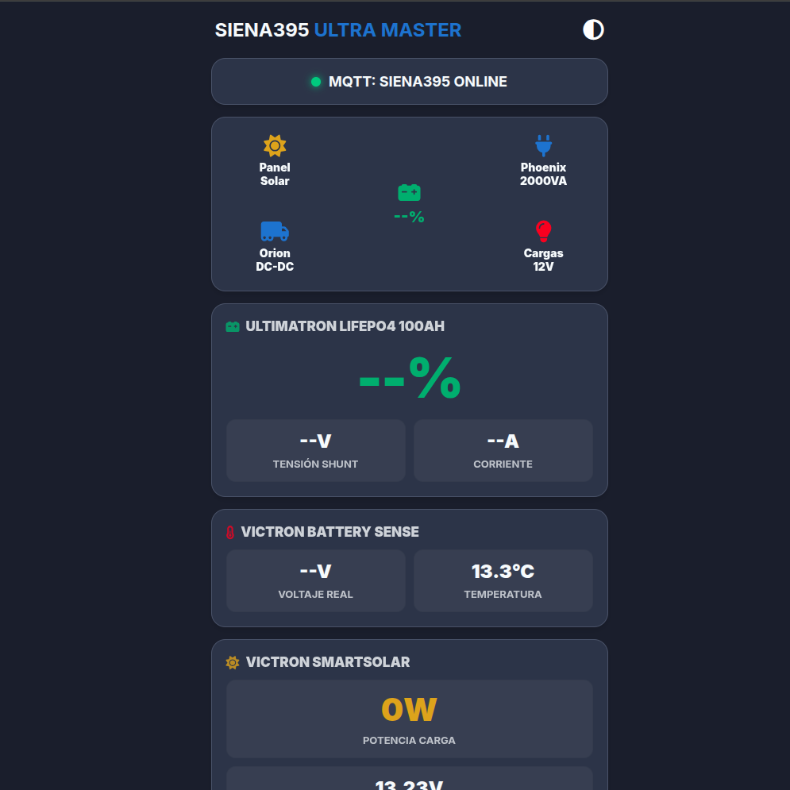

# 🚐 Siena395 Master Ultra - Sistema de Monitorización

Este repositorio contiene el código del Dashboard/Interfaz web para la monitorización en tiempo real en autocaravana, camper, furgo, etc. con equipamiento de equipos victron. El sistema permite visualizar el estado energético del vehículo desde cualquier lugar del mundo. 

## 🔋 Hardware del Sistema
- **Batería:** Smartcell LiFePO4 280Ah.
- **Cerebro:** ESP32 / ESP32-S3 (Recopilación de datos vía Bluetooth BLE).
- **Equipos Victron:** SmartShunt, MPPT SmartSolar, Orion-Tr Smart, Phoenix Inverter y Battery Sense.
- **Configuración ESPHome:** [Ver archivo YAML](./siena395_bms.yaml)

## 🚀 Funcionalidades del Dashboard
- **Flujos de energía:** Animación en tiempo real de la dirección de la corriente (Solar, Alternador, Consumos).
- **Gestión de Umbrales Críticos:** Sistema de alertas dinámicas basado en la curva de descarga de la Ultimatron, con avisos críticos por debajo de 12.1V o 20% de capacidad residual.
- **Corriente dinámica:** Los valores de Amperios cambian a verde (carga) o rojo (descarga) automáticamente.
- **Histórico dinámico:** Gráfico de evolución del SOC (%) generado en tiempo real.
- **Diseño Ultra:** Interfaz optimizada para móviles y tablets con modo oscuro.

## 📡 Arquitectura de Datos (MQTT)
- **Broker:** `ZZZ.ZZZZ` puede ser broker público o privado. 
  
## 🤝 Agradecimientos y Origen del Proyecto
Este ecosistema de monitorización no habría sido posible sin la base técnica proporcionada por:
- **Fabian-Schmidt (esphome-victron_ble):** Por el desarrollo del componente esencial que permite al ESP32 capturar los datos "Instant Readout" de Victron vía Bluetooth.
- **DIY Electro Camper:** Por la lógica de control y la integración de la BMS en ESPHome que sirvió de inspiración para el proyecto.
- **Syssi (GitHub):** Por su trabajo con el componente JBD-BMS.
- **Comunidad ESPHome:** Por proporcionar el framework que une todas estas piezas.

## ⚖️ Licencia
**MONITORIZACIÓN AUTOCARAVANA - &#127279; 2026 UZTURRE - Software Libre.**
Este proyecto se distribuye con la esperanza de que sea útil para otros usuarios de autocaravanas. Se permite su uso, modificación y distribución siempre que se mantenga esta filosofía de libertad.

